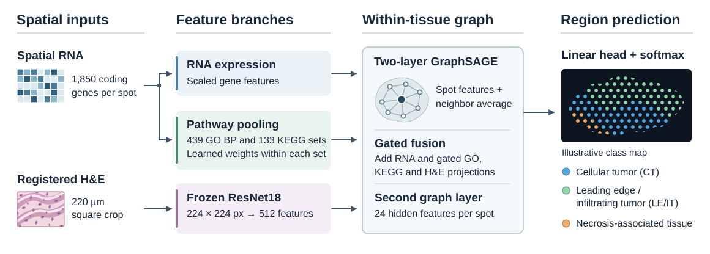
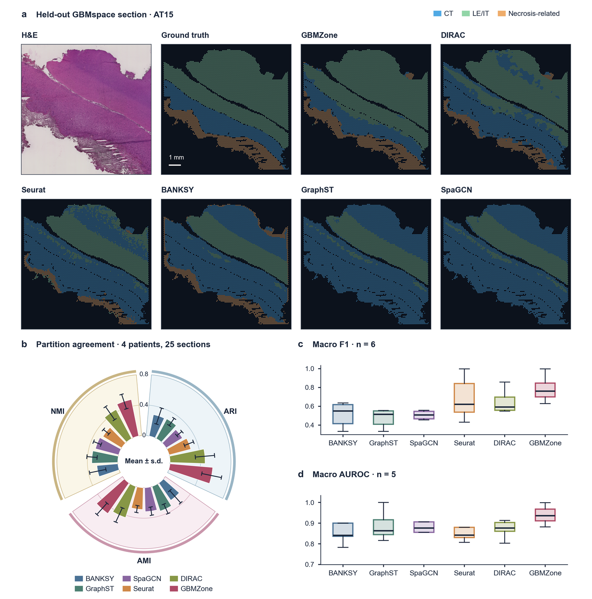

# GBMZone

GBMZone predicts glioblastoma tissue regions from spatial transcriptomics and registered hematoxylin and eosin (H&E) images. A two-layer GraphSAGE model uses a within-tissue graph and combines RNA expression with optional GO/KEGG pathway features and frozen ResNet18 image features. It returns probabilities for cellular tumor, leading edge or infiltrating tumor, and necrosis-associated tissue.

The repository contains the model, input loaders, training and inference code. Supply processed spatial inputs and the model reference or checkpoint separately.

## Model workflow



Both the expression and pathway branches start from the same 1,850 coding genes. The model learns separate weights for genes within each pathway and separate gates for the GO, KEGG and image inputs. Each graph layer combines a spot's own features with the mean of its within-tissue neighbors.

## Figure 4 · Pathology-region prediction in GBMspace

The benchmark covers 38 GBMspace sections from six patients. GBMZone used each patient's held-out checkpoint for all of that patient's sections. The registered H&E image and pathology annotations are from de Jong et al. [GBMspace study](https://doi.org/10.1038/s41586-026-11234-8) · [Visium dataset E-MTAB-17164](https://www.ebi.ac.uk/biostudies/arrayexpress/studies/E-MTAB-17164)



**A.** Pathology labels and all six methods are shown at the same 9,331 labeled spots in section `AT15-BRA-4-FO-G1-S21`. [Full-resolution Figure 4 (PDF)](results/figure4/Figure4.pdf)

**B.** The circular plot shows patient means and sample standard deviations for adjusted Rand index (ARI), adjusted mutual information (AMI) and normalized mutual information (NMI). The 25 sections with at least two pathology classes represent four patients. Section scores were averaged within each sampling site, then across sites within each patient.

**C and D.** The boxplots show the median and interquartile range of held-out macro F1 for six patients and macro AUROC for five. The table gives the patient means for all five metrics.

| Method | ARI | AMI | NMI | Macro F1 | Macro AUROC |
| --- | ---: | ---: | ---: | ---: | ---: |
| BANKSY | 0.286 | 0.275 | 0.276 | 0.574 | 0.872 |
| GraphST | 0.293 | 0.340 | 0.341 | 0.550 | 0.888 |
| SpaGCN | 0.249 | 0.314 | 0.315 | 0.560 | 0.881 |
| Seurat | 0.294 | 0.286 | 0.288 | 0.682 | 0.868 |
| DIRAC | 0.461 | 0.430 | 0.431 | 0.645 | 0.872 |
| **GBMZone** | **0.564** | **0.487** | **0.488** | **0.783** | **0.940** |

BANKSY, GraphST and SpaGCN use their native spatial domains for partition agreement. For the class maps and classification scores, each domain takes the class with the largest average Seurat score from the fold-specific reference. The CSVs include the AT15 spot predictions, section agreement scores, and patient and class metrics. In the spot table, pathology class codes `0`, `1` and `2` denote CT, LE/IT and necrosis-associated tissue, respectively. [Figure 4 source data](results/figure4/source-data/)

## Installation

Use Python 3.10 and run commands from the repository root.

```bash
python -m venv .venv
source .venv/bin/activate
python -m pip install -r requirements.txt
```

Select `--device cpu` for CPU execution or `--device cuda` with a CUDA-enabled PyTorch installation.

## Processed inputs

| File | Contents |
| --- | --- |
| `genes.csv` | `stable_id` column in the exact order of the RNA matrix columns and model reference. |
| `cache/<sample>/log_cpm.npz` | SciPy sparse matrix with spatial units as rows and model genes as columns. Use log1p counts per 10,000, with the library denominator computed over all coding genes before subsetting columns. |
| `cache/<sample>/adjacency.npz` | SciPy sparse, nonnegative graph matrix in the same row order. Build edges within the tissue mask and keep separate tissue components disconnected. |
| `cache/<sample>/nodes.npz` | NumPy archive with an aligned `unit_id` array. Training and evaluation also use `y` (three soft class proportions per unit), `mask` (eligible labels), and `hard` (eligible hard labels for held-out evaluation). |
| `features/<sample>.npz` | NumPy archive with the same `unit_id` array and `image_features` of shape `(n_units, 512)`. Required for H&E models. |
| `samples.csv` | Training metadata with `sample`, `patient`, and `site` columns. Use one row per section. |

Save NumPy identifiers as strings or integers so they load without pickle. Class proportions in eligible rows of `y` sum to one and follow the reference's class order. Use the same node order across each section's RNA, graph, labels and image features.

For H&E, `load_encoder` and `extract_he_features` in `algorithm/model.py` embed registered RGB images using the frozen ResNet18 state in the reference bundle. Pass each spatial unit's image coordinates in `(x, y)` order and the image scale in pixels per micrometer. The function samples a 220 µm square on a 224 × 224 grid and returns one vector per supplied center. Registration and tissue graph construction are upstream preparation steps.

## Predict tissue regions

```bash
python algorithm/predict.py \
  --weights 'checkpoints/pathway+he+tran.pt' --fold 0 \
  --genes-csv inputs/genes.csv --cache-dir inputs/cache \
  --features-dir inputs/features --sample section_01 \
  --device cpu --output outputs/section_01.npz
```

Set `--fold` to the fold to use from a trusted checkpoint. Inference uses its fitted preprocessing and writes `probabilities`, `unit_id`, and `classes` to a new `.npz`. For RNA-only and RNA-plus-pathway checkpoints, omit `--features-dir`. Load PyTorch checkpoint bundles only from a trusted source.

## Train on new data

```bash
python algorithm/train.py \
  --reference 'checkpoints/pathway+he+tran.pt' \
  --samples-csv inputs/samples.csv --genes-csv inputs/genes.csv \
  --cache-dir inputs/cache --features-dir inputs/features \
  --train-patients donor_01 donor_02 --validation-patients donor_03 \
  --methods pathway_he_tran --epochs 100 --seed 2026111682 \
  --device cpu --output-dir outputs/training
```

Choose `tran` (RNA), `pathway_tran` (RNA and pathways), `he_tran` (RNA and H&E), or `pathway_he_tran` (all inputs). Training initializes the graph model from scratch and fits scaling on the training patients. It reports held-out patient metrics after fitting. Each output bundle contains one fold at index `0`.

The `--reference` input supplies class order, gene order, pathways, and the optional frozen image encoder. An existing full-model bundle provides these definitions. To construct a reference for new inputs, save a dictionary with `torch.save` containing `classes`, `gene_order` (with an ordered `stable_id` list), `pathways` (pathway metadata), and `folds` (a list with a dictionary containing `mask` and `groups` at index `0`). Use a gene-by-pathway Boolean `mask` with at least one gene per pathway. Give `groups` one entry per pathway with `GO_BP` or `KEGG`. For H&E models, also provide `image_encoder_state` (ImageNet ResNet18 state dictionary) and `image_encoder` (encoder metadata).
